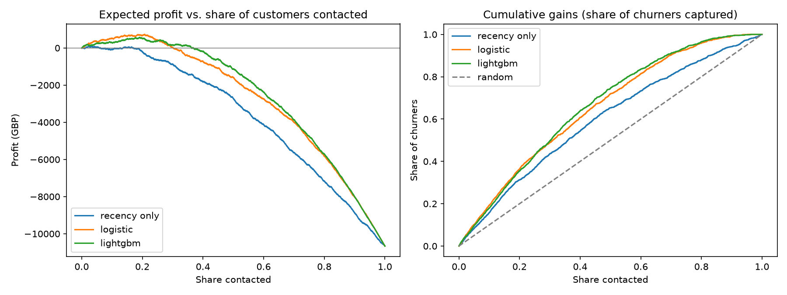
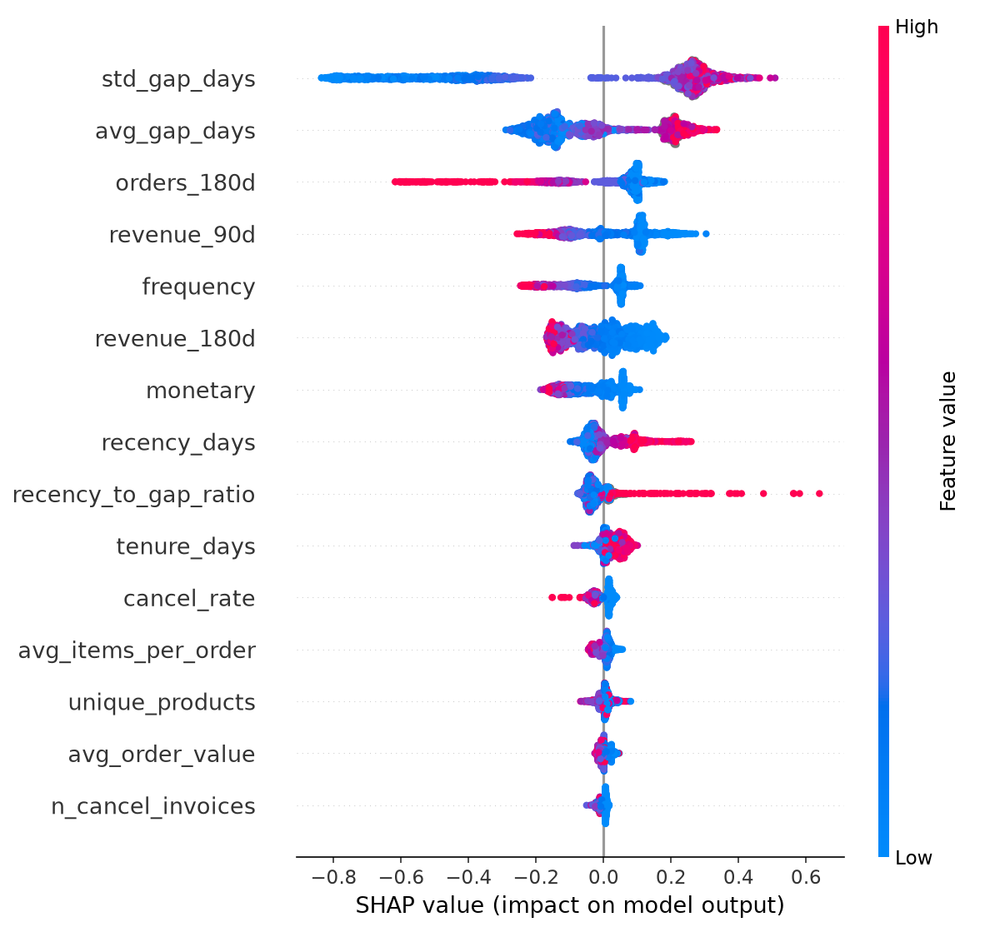

# Customer Churn Prediction (UCI Online Retail II)

End-to-end data science project: business framing, leakage-safe features, benchmarks, gradient boosting,
probability calibration, profit-based evaluation, batch scoring, REST API, dashboard, tests and Docker.

## Pipeline
```
raw xlsx -> load_clean.py -> transactions_clean.parquet
         -> features.py   (snapshots at cutoff dates, labels from the next 90 days)
         -> train.py      (recency benchmark, logistic regression, LightGBM + isotonic calibration)
         -> score.py      (score all active customers today)
         -> app/api.py (FastAPI)   app/dashboard.py (Streamlit)
```
**Time-based split** (no random shuffling): train on cutoffs 2010-06 to 2011-03, validate on 2011-06,
test on 2011-09. Label windows never overlap the next split.

## Quick start
```bash
python -m venv .venv
source .venv/bin/activate          # Windows: .venv\Scripts\activate
pip install -r requirements.txt

# 1. Put online_retail_II.xlsx in data/raw/ (https://archive.ics.uci.edu/dataset/502/online+retail+ii)
python src/load_clean.py
python src/train.py
python src/score.py
python -m pytest -q

# 2. Serve
uvicorn app.api:app --reload       # http://127.0.0.1:8000/docs
streamlit run app/dashboard.py
```
No data yet? Test the whole pipeline on synthetic data (results are NOT real):
```bash
python src/make_synthetic_data.py
python src/load_clean.py --input data/raw/synthetic_retail.csv
python src/train.py && python src/score.py
```
Run all commands from the project root. `make` shortcuts exist in the Makefile (Mac/Linux).

## Outputs
| File | What it is |
|---|---|
| `models/churn_model.joblib` | model + calibrator + feature list |
| `reports/metrics.json` | all test metrics, segment AUCs, feature importance |
| `reports/profit_and_gain.png` | profit vs. share contacted, cumulative gains |
| `reports/calibration.png`, `shap_summary.png` | calibration and drivers |
| `data/processed/scores.parquet` | current risk scores with recommended actions |

## API
- `GET /health`, `GET /features`
- `POST /predict` with `{"customers": [{"recency_days": 45, "frequency": 6, "monetary": 900}]}`
- `GET /score/{customer_id}` returns probability, tier, top driver and recommended action

Docker: `docker build -t churn-api . && docker run -p 8000:8000 churn-api` (after training and scoring).


## Results (fill in from your real run)
| Model | ROC AUC | Lift@10% | Best profit (GBP) |
|---|---|---|---|
| Recency only | 0.658 | 1.58x | -702 |
| Logistic regression | 0.752 | 1.93x | -166 |
| LightGBM (calibrated) | 0.766 | 1.79x | +196 |

## Honest limitations
- Only two years of data; seasonality is weakly represented.
- Economics (cost, value, save rate) are assumptions: validate with an A/B test.
- Calibration set and early-stopping set are the same validation snapshot.
